<div align="center">


### An AI-assisted SQL learning and analytics platform for students and instructors

*Learn SQL by doing — with GPT-4 generated practice, AI-assisted grading, gated learning paths, and instructor analytics dashboards, backed by a normalized MySQL learning-record store on Google Cloud.*

<br/>

[**Linda Perez**](https://github.com/lindaperez)<sup>1</sup> ·
[**Feiyan Zhou**](https://github.com/zhoufeiyn)<sup>1</sup> ·
[**Lisa Liu**](https://github.com/lisaqyliu)<sup>1</sup>

<sup>1</sup> Northeastern University — CS5200 Database Management Systems · Spring 2025

<sub>Linda Perez: project lead, full stack, database architecture,analytics, deployment&nbsp;&nbsp;·&nbsp;&nbsp;Feiyan Zhou: LLM SQL practice, AI grading, analytics&nbsp;&nbsp;·&nbsp;&nbsp;Lisa Liu: UI, DB workflows</sub>

<br/>


[Overview](#overview) ·
[Demo](#demo) ·
[Architecture](#architecture) ·
[Features](#features) ·
[Data Model](#data-model) ·
[Installation](#installation) ·
[Deployment](#deployment)

</div>

---

## Overview

**DB_QueryMinds** is a full-stack learning platform that teaches SQL by *practicing against a real relational schema* and getting *instant, AI-assisted feedback*. It pairs a normalized MySQL learning-record store with OpenAI GPT-4 to generate practice questions, synthesize multiple-choice assessments, grade student work, and surface cohort-level analytics for instructors.

The platform serves three roles from a single Django codebase, each with a tailored experience:

```mermaid
%%{init: {'theme':'base','themeVariables':{'fontFamily':'Segoe UI, Helvetica, Arial, sans-serif','fontSize':'14px','primaryTextColor':'#2d3e50','lineColor':'#8aa1b5'}}}%%
flowchart TB
  Root["DB_QueryMinds"]:::root

  Root --> S["Student"]:::student
  Root --> I["Instructor"]:::instructor
  Root --> A["Admin"]:::admin

  S --> S1["Gated learning path"]:::student
  S --> S2["AI SQL practice"]:::student
  S --> S3["MCQ and free-text answers"]:::student
  S --> S4["Progress tracking"]:::student

  I --> I1["Chapter and exercise authoring"]:::instructor
  I --> I2["GPT-4 question generation"]:::instructor
  I --> I3["AI grading and feedback"]:::instructor
  I --> I4["Cohort analytics dashboard"]:::instructor

  A --> A1["Role-based access"]:::admin
  A --> A2["MySQL record management"]:::admin
  A --> A3["Cloud SQL operations"]:::admin

  classDef root fill:#dbe6f0,stroke:#7a9bbb,stroke-width:1.5px,color:#23364a
  classDef student fill:#dfeae2,stroke:#8ab39a,color:#26402f
  classDef instructor fill:#e6e2f0,stroke:#a99ec9,color:#352b4a
  classDef admin fill:#f0ebe0,stroke:#c9b88a,color:#4a3f23
```

**Why it stands out as an engineering project:**

- **LLM in the loop, not just a chatbot** — GPT-4 generates questions, distractors, MCQs, and grades answers, with defensive lazy-client initialization so a missing API key never takes down authentication.
- **Real database engineering** — 20+ normalized tables, association entities, and analytics built on Django ORM aggregations (`Avg`, `Count`, weighted ranking).
- **Cloud-native and deployable** — runs on Google App Engine (standard) with Cloud SQL for MySQL via the Cloud SQL Auth Proxy, secrets in `.env`, static served by WhiteNoise.
- **Data-driven UX** — instructor dashboards render live Chart.js visualizations computed from SQL aggregation queries.

---

## Demo

> Every capture below is a **real screenshot** of the running app in the **student** role — not a mockup. They are reproducible end-to-end via [`docs/demo/capture.py`](docs/demo/capture.py) (Playwright drives a logged-in student through each flow). The AI screens (steps 4–6) are **live GPT-4 output**.

### 🎓 The student journey

A student signs in, works through a gated learning path, sharpens skills with AI-generated practice, watches their analytics improve, and stays in touch with their instructor — all from one role-aware UI.

<table>
  <tr>
    <td width="50%" valign="top">
      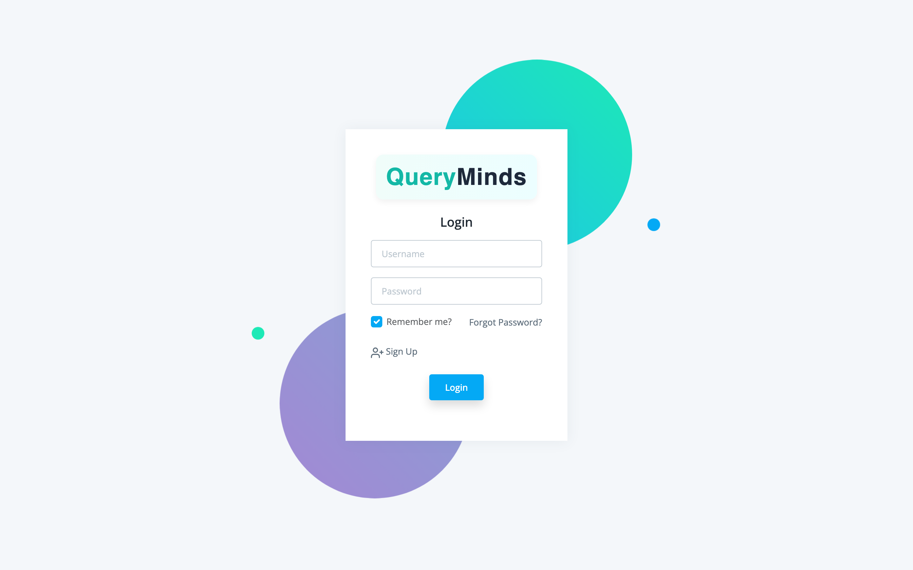
      <p align="center"><b>1 · Sign in</b><br/><sub>Role-aware authentication. New students auto-enroll into the demo course and every chapter on registration.</sub></p>
    </td>
    <td width="50%" valign="top">
      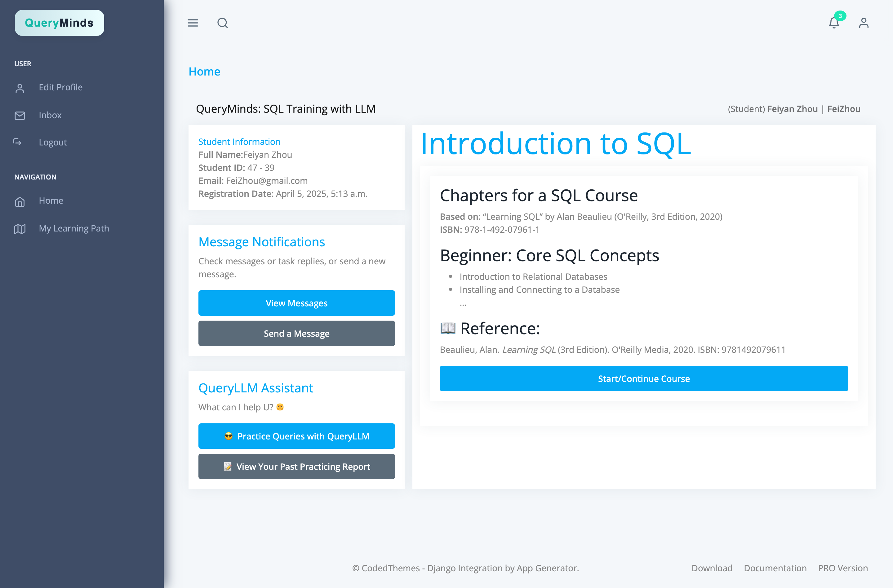
      <p align="center"><b>2 · Student dashboard</b><br/><sub>Profile, messages, the SQL course, and one-tap access to the QueryLLM practice assistant.</sub></p>
    </td>
  </tr>
</table>

#### 3 · Gated learning path

<div align="center">
  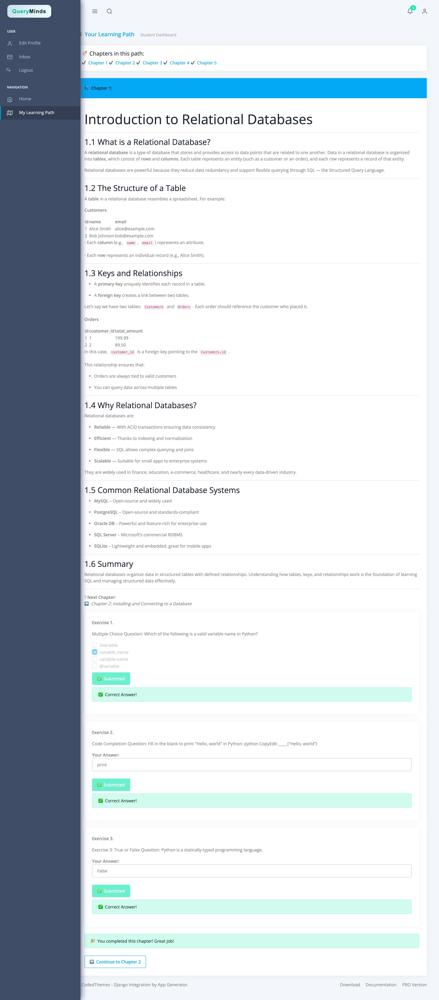
  <p><sub>Chapters unlock <b>sequentially</b> — each one opens only when the previous is complete. Exercises auto-score (MCQ + free-text), attempts are capped, and finishing a chapter stamps completion and reveals <i>“Continue to Chapter&nbsp;2.”</i></sub></p>
</div>

#### 4–6 · AI-assisted SQL practice (live GPT-4)

<table>
  <tr>
    <td width="50%" valign="top">
      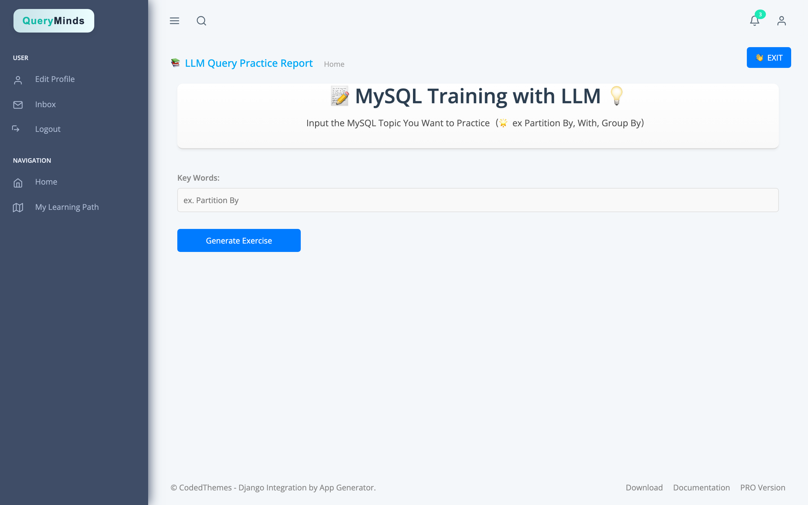
      <p align="center"><b>4 · Pick a topic</b><br/><sub>Type a keyword — <code>JOIN</code>, <code>PARTITION BY</code>, <code>GROUP BY</code> — and let the assistant build a practice set.</sub></p>
    </td>
    <td width="50%" valign="top">
      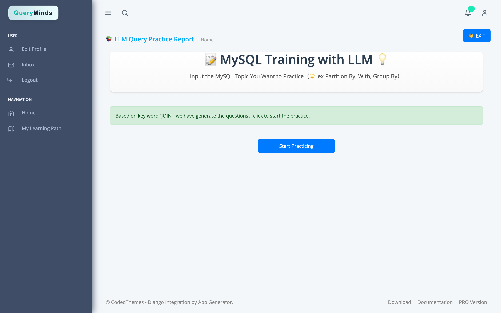
      <p align="center"><b>5 · GPT-4 generates</b><br/><sub>Three schema-grounded MySQL tasks are generated on the fly against the sample <code>employee</code>/<code>department</code> schema.</sub></p>
    </td>
  </tr>
  <tr>
    <td width="50%" valign="top">
      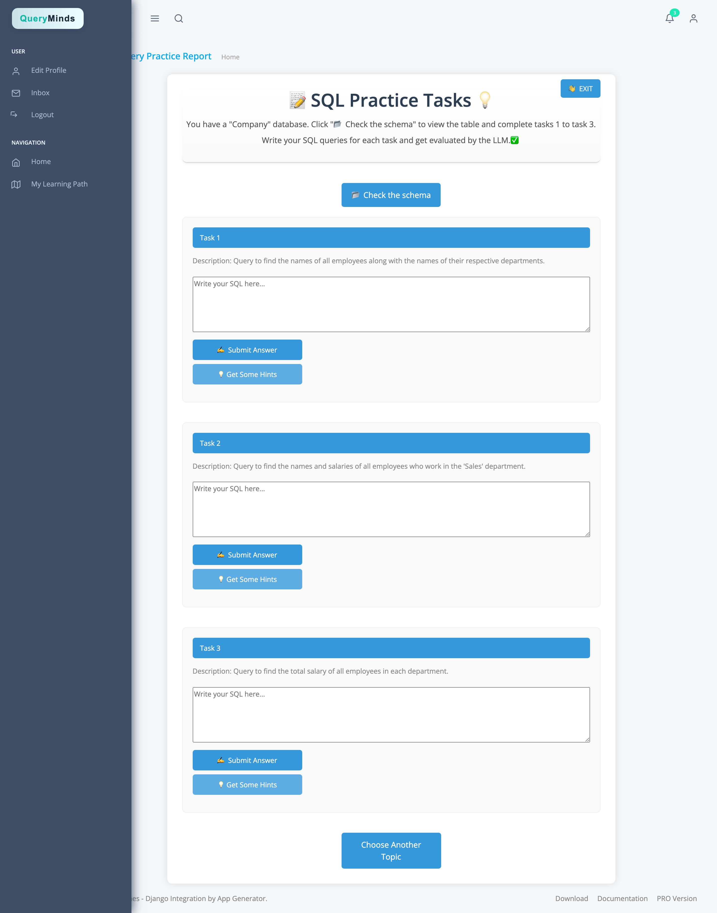
      <p align="center"><b>6a · Practice & auto-grade</b><br/><sub>Write SQL for each task; the LLM scores answers 0–100 with feedback and on-demand hints.</sub></p>
    </td>
    <td width="50%" valign="top">
      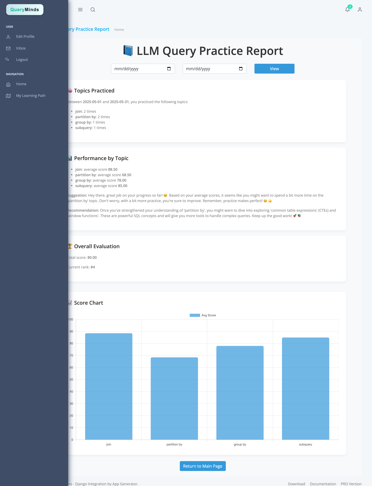
      <p align="center"><b>6b · Personal analytics</b><br/><sub>A practice report ranks the student against peers and adds GPT-4 study recommendations over a live Chart.js score-by-topic chart.</sub></p>
    </td>
  </tr>
</table>

#### 7 · Message your instructor

<div align="center">
  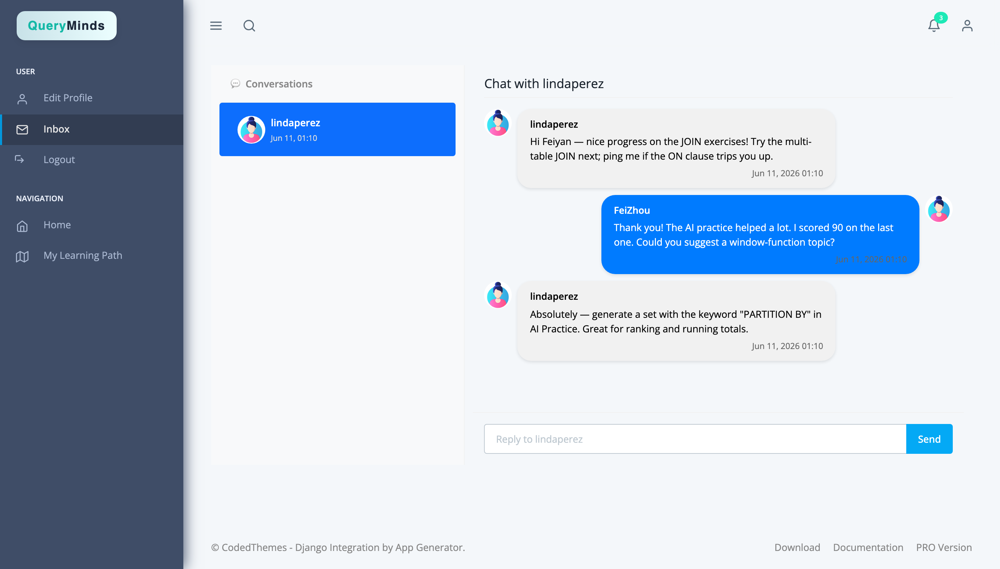
  <p><sub>Threaded student ⇄ instructor conversations with sent/received bubbles and an AJAX live-refresh inbox.</sub></p>
</div>

### 🧑‍🏫 The instructor experience

On the other side of the same codebase, an instructor authors the curriculum, lets GPT-4 draft assessments, and reads cohort-level analytics computed from raw submissions.

<table>
  <tr>
    <td width="50%" valign="top">
      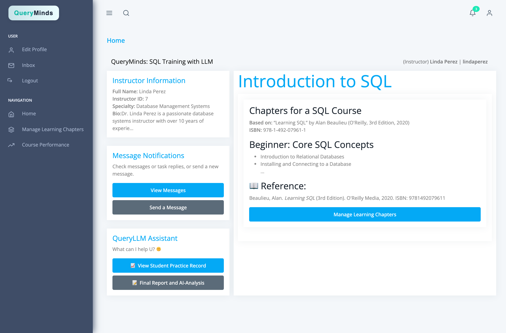
      <p align="center"><b>1 · Instructor home</b><br/><sub>Role-aware landing — profile, messages, and shortcuts into chapter management and the AI analytics assistant.</sub></p>
    </td>
    <td width="50%" valign="top">
      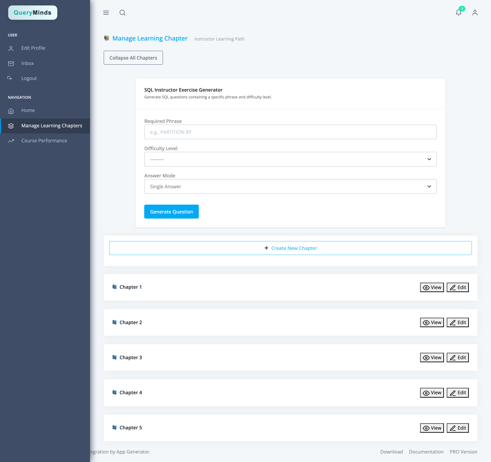
      <p align="center"><b>2 · Author the curriculum</b><br/><sub>Create chapters, exercises, and evaluations. New chapters fan out to every enrolled student automatically.</sub></p>
    </td>
  </tr>
</table>

#### 3 · Generate assessments with GPT-4 (live)

<div align="center">
  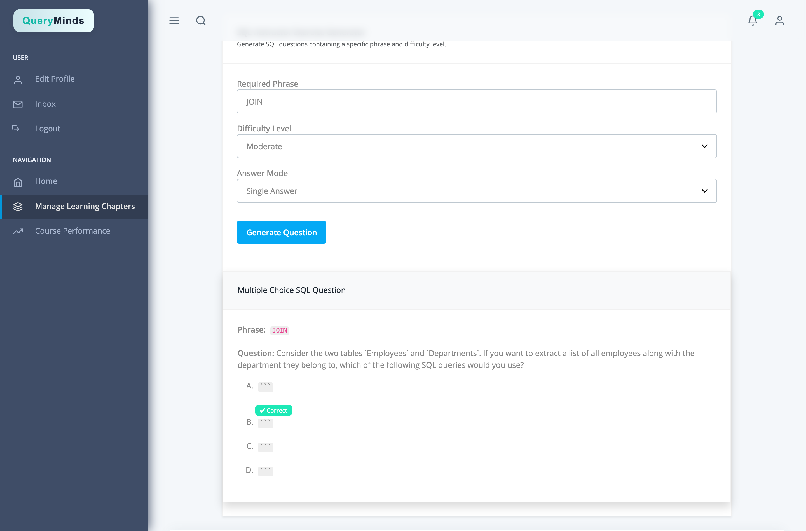
  <p><sub>Give a required phrase (e.g. <code>JOIN</code>) and a difficulty; GPT-4 returns a multiple-choice SQL question with four options and the correct answer flagged. Output is regex-parsed into <code>Exercise</code> + <code>MultipleOption</code> rows ready to attach to a chapter.</sub></p>
</div>

#### 4 · Cohort analytics dashboard

<div align="center">
  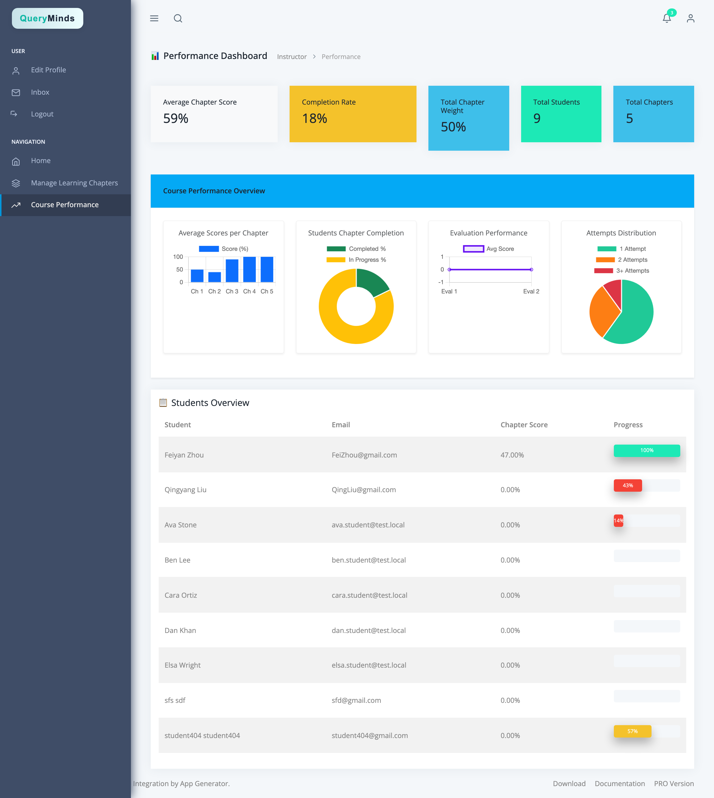
  <p><sub>Server-side Django ORM aggregations (<code>Avg</code>, <code>Count</code>, weighted scoring) become live Chart.js visuals — average chapter score, completion rate, evaluation performance, and attempt distribution — over a per-student progress table.</sub></p>
</div>

#### 5 · AI teaching assistant

<div align="center">
  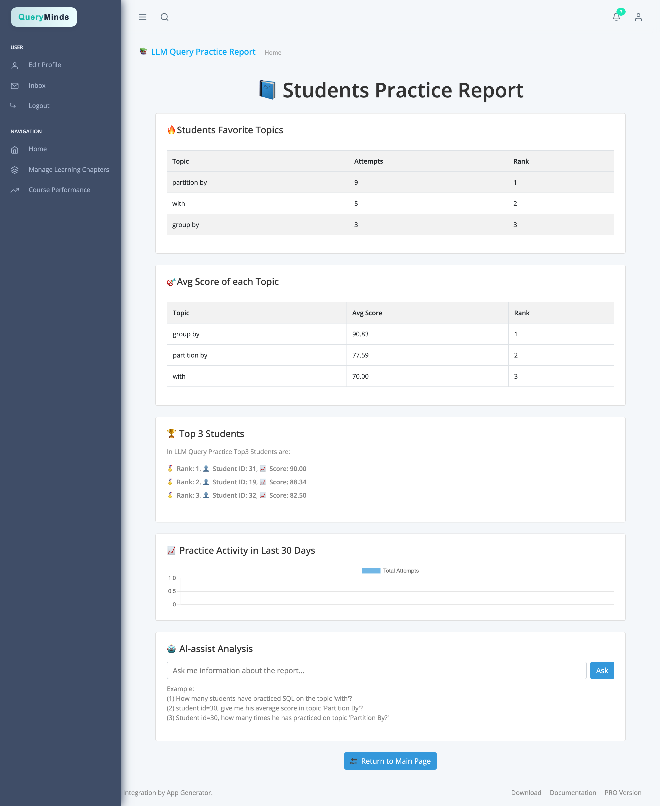
  <p><sub>A practice report ranks topics by attempts and average score, surfaces the top students, and offers a GPT-4 Q&amp;A box for ad-hoc questions about the cohort's practice history.</sub></p>
</div>

<details>
<summary><b>60-second guided walkthrough (script)</b></summary>

1. **Register** as a student and get auto-enrolled into the demo course and chapters.
2. Open the **Learning Path** — only Chapter 1 is unlocked.
3. **Answer** the chapter's exercises (MCQ and free text) — scores compute instantly, attempts are capped.
4. Finish the chapter — **Chapter 2 unlocks** automatically.
5. Switch to **AI Practice** — type a topic keyword (for example `JOIN`, `PARTITION BY`) and GPT-4 returns 3 questions with answers and explanations.
6. Log in as an **instructor** and open the **Chapter Dashboard** — generate an MCQ with GPT-4 and attach it to a chapter.
7. Open **Course Performance** — the Chart.js dashboard renders cohort scores, completion rate, and attempt distribution.

</details>

---

## Architecture

### System overview

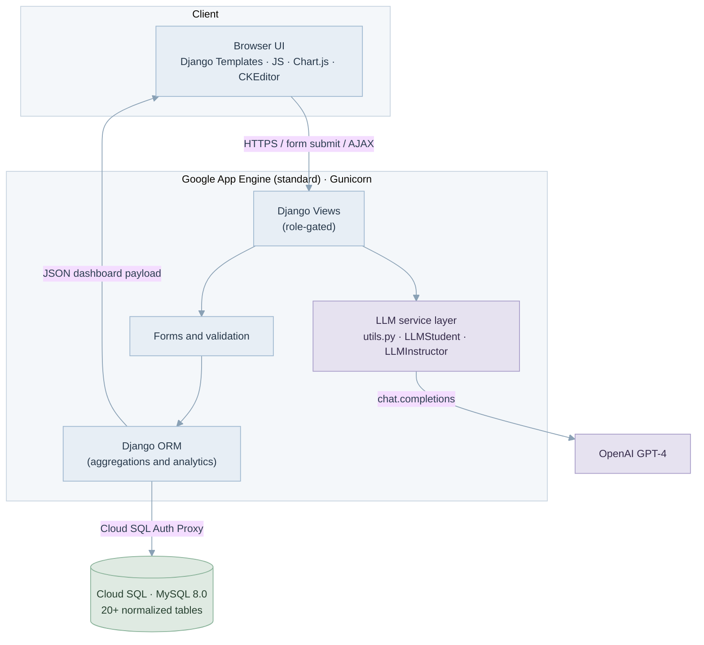

### Request lifecycle — AI question generation

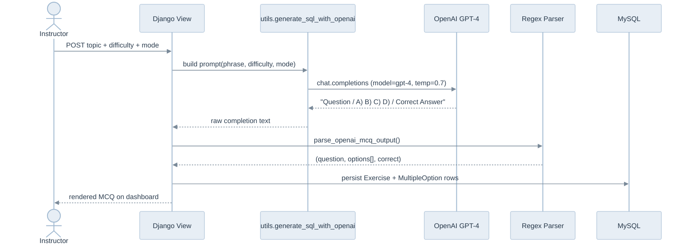

### Student learning-path state machine

A chapter unlocks only when the previous one is completed, enforcing sequential mastery.

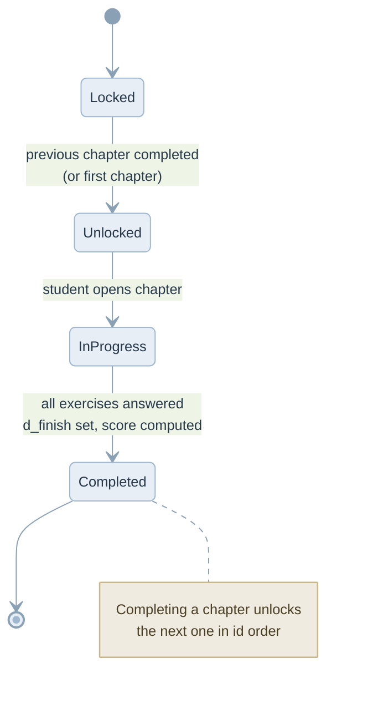

### Tech stack

| Layer | Technology |
|---|---|
| Backend | Python 3.12, Django 4.2 |
| Database | MySQL 8.0 (Cloud SQL), Django ORM |
| AI | OpenAI Python SDK, GPT-4 (`chat.completions`) |
| Frontend | Django Templates, HTML5/CSS3, JavaScript (ES6), Chart.js |
| Rich text | CKEditor (`django-ckeditor`) |
| Analytics | ORM aggregations (`Avg`, `Count`), weighted scoring, ranking |
| Static assets | WhiteNoise |
| Server | Gunicorn (WSGI) |
| Deployment | Google App Engine (standard) + Cloud SQL Auth Proxy |
| Config / secrets | `python-dotenv`, `.env`, App Engine env vars |

---

## Features

### By role

| Role | Capabilities |
|---|---|
| Student | Browse a gated SQL learning path · complete MCQ and free-text exercises with auto-scoring and capped attempts · generate AI SQL practice from a topic keyword · track progress and scores · message instructors |
| Instructor | Author chapters, exercises, and evaluations · generate single or multiple-choice SQL questions with GPT-4 · attach AI assessments to chapters · view cohort analytics (Chart.js) · drill into per-student performance · AI assistant for reviewing student records |
| Admin | Role-based access control · manage the MySQL learning-record store · operate Cloud SQL (start/stop, import/restore) |

### Functional highlights

- **Role-based authentication** — `UserProfile.user_type` drives student/instructor branching; new students auto-enroll into the demo course and every chapter via `get_or_create` (`StudentCourse`, `ChapterStudent`).
- **Gated learning path** — chapters unlock sequentially; completion is detected when answered-exercise count equals total exercises, then `d_finish` is stamped and the chapter score is recomputed.
- **Dual-mode exercises** — multiple-choice (scored by exact set match against correct options) and free-text (scored against the stored correct option), both with `max_attempts` enforcement.
- **AI question generation** — instructors generate single-answer or 4-option MCQs; output is regex-parsed into structured `Exercise` and `MultipleOption` rows. Includes a deterministic, schema-aware fallback generator for `PARTITION BY`, CTE, and `WHERE` patterns.
- **AI SQL practice (students)** — `LLMStudent` produces 3 schema-grounded MySQL practice tasks from a keyword, records answers and `f_score`, and stores a per-topic practice history.
- **AI assistant (instructors)** — `LLMInstructor` summarizes a student's practice record over a date range (topic, attempts, average score) to inform feedback.
- **Analytics dashboard** — `course_performance` computes total students, completion rate, weighted chapter scores, average evaluation scores, per-chapter averages, and attempt distribution, serialized to JSON for Chart.js.
- **Messaging** — student / instructor inbox with conversation threading and AJAX live message fetch.

---

## Data Model

The schema is a normalized relational design (MySQL 8.0) with association tables linking chapters, exercises, evaluations, and students. Full entity-relationship diagram:

<div align="center">

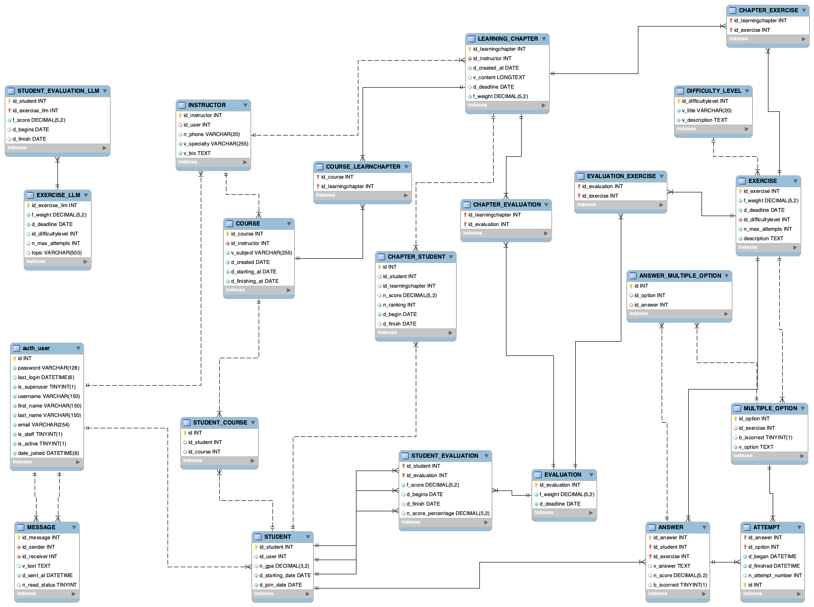

</div>

### Core entities (simplified)

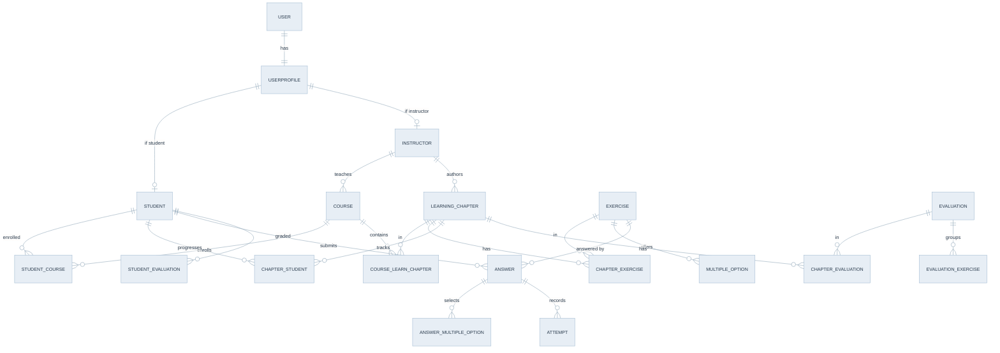

**Key tables:** `Instructor`, `Student`, `Course`, `LearningChapter`, `Exercise`, `MultipleOption`, `DifficultyLevel`, `Evaluation`, association tables (`ChapterExercise`, `ChapterEvaluation`, `EvaluationExercise`, `CourseLearnChapter`, `StudentCourse`, `ChapterStudent`), submissions (`Answer`, `AnswerMultipleOption`, `Attempt`, `StudentEvaluation`), and `Message`.

---

## Analytics

The instructor **Course Performance** view turns raw submission rows into decision-ready visualizations. All metrics are computed server-side with Django ORM aggregations and shipped to the client as a single JSON payload consumed by Chart.js.

| Metric | How it is computed |
|---|---|
| Completion rate | completed `ChapterStudent` rows ÷ (chapters × students) |
| Average chapter score | `Avg(n_score)` over finished chapters |
| Average evaluation score | `Avg(f_score)` over `StudentEvaluation` |
| Per-chapter averages | grouped `Avg(n_score)` per `LearningChapter` |
| Weighted student score | Σ `(chapter_score / 100 × chapter weight)` |
| Attempt distribution | `Count` of `Attempt.n_attempt_number` bucketed into 1 / 2 / 3+ |
| Per-student progress % | distinct attempted exercises ÷ total exercises |

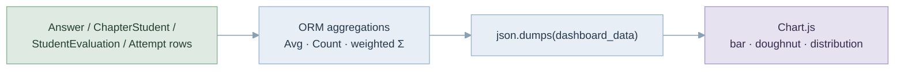

---

## Installation

### Prerequisites

- Python 3.12
- MySQL 8.0 (local) or access to the Cloud SQL instance via the Auth Proxy
- An OpenAI API key (for AI features)

### 1. Clone and create a virtual environment

```bash
git clone <REPO_URL>
cd Project_SQL/query_minds_project_web_app

python -m venv venv
source venv/bin/activate           # Windows: venv\Scripts\activate
pip install -r requirements.txt
```

### 2. Configure environment variables

Create a `.env` file in `query_minds_project_web_app/`:

```bash
OPENAI_API_KEY=sk-...
DB_NAME=neu_db_project
DB_USER=neu-db-user
DB_PASSWORD=your_password
DB_HOST=127.0.0.1
DB_PORT=3306
DJANGO_SETTINGS_MODULE=query_minds_project_web_app.settings
```

> Never commit `.env`. The LLM client is initialized lazily, so the app still boots and serves authentication even when `OPENAI_API_KEY` is unset — only AI features are disabled.

### 3. (Cloud SQL) start the Auth Proxy

```bash
./cloud-sql-proxy queryminds:us-west2:neu-db-project --port 3306
```

### 4. Migrate and run

```bash
python manage.py migrate
python manage.py runserver
```

Open **http://127.0.0.1:8000**, register as a student or instructor, and start exploring.

### Loading sample data

Pre-built schema and data dumps live in [`DB_dumps/`](DB_dumps/). For a full local restore:

```bash
mysql -u root -p neu_db_project < ../DB_dumps/schema_data_dump_04_05_2025.sql
```

---

## Deployment

Configured for **Google App Engine (standard)** with **Cloud SQL for MySQL**.

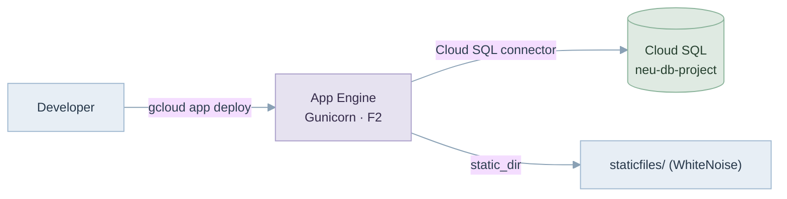

```bash
# Deploy
gcloud config set project queryminds
gcloud app deploy app.yaml

# Cost control — stop / start Cloud SQL when idle
gcloud sql instances patch neu-db-project --activation-policy=NEVER
gcloud sql instances patch neu-db-project --activation-policy=ALWAYS
```

`app.yaml` highlights: `runtime: python312`, `entrypoint: gunicorn ... wsgi:application`, `instance_class: F2`, a static handler for `staticfiles/`, and the Cloud SQL connection name under `beta_settings`.

> Full provisioning runbook (Cloud SQL creation, DB import, IAM, billing) is documented in [`implementation.md`](implementation.md) and [`billing.md`](billing.md).

---

## Project Structure

```text
Project_SQL/
├── ERD.png                          # Entity-relationship diagram
├── DB_dumps/                        # MySQL schema + data dumps
├── cloud-sql-proxy                  # Cloud SQL Auth Proxy binary
├── implementation.md                # GCP provisioning runbook
├── billing.md                       # Cost tracking
└── query_minds_project_web_app/
    ├── app.yaml                     # App Engine config
    ├── manage.py
    ├── requirements.txt
    ├── query_minds_project_web_app/ # Project settings, urls, wsgi/asgi
    └── myapp/                       # Main application
        ├── models/                  # 20+ ORM models (one file each)
        ├── views.py                 # Auth, learning path, instructor, analytics
        ├── LLMStudent.py            # GPT-4 student practice generation
        ├── LLMInstructor.py         # GPT-4 instructor AI assistant
        ├── utils.py                 # OpenAI client + question gen/parse
        ├── forms.py                 # Django forms and formsets
        ├── migrations/
        └── templates/               # Role-based UI (student / instructor / llm / user)
```

---

## Roadmap

- [ ] Live in-browser SQL execution sandbox against a sample schema
- [ ] Migrate LLM calls to a streaming and async service with retry/backoff
- [ ] Move secrets to Google Secret Manager; disable `DEBUG` in production
- [ ] Replace exact-match grading with semantic SQL-equivalence checking
- [ ] Add an automated test suite and CI (GitHub Actions)
- [ ] Export analytics to CSV and scheduled instructor email digests

---

## Notes on Production Readiness

- Settings currently read DB credentials and `OPENAI_API_KEY` from `.env`. For production, prefer Google Secret Manager and set `DEBUG = False`.
- Keep API keys, DB passwords, and the Django `SECRET_KEY` out of version control.

## License

Released under the [MIT License](LICENSE).

<div align="center">
<br/>
<sub>Built for NEU CS5200 Database Management Systems · Spring 2025</sub>
</div>
